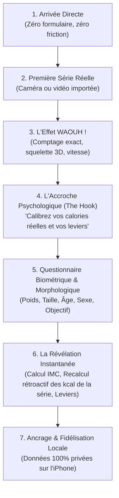

# Parcours d'Engagement Psychologique & Profilage Progressif (Sans Paywall)

> **Vision Produit — David Dabert (9 Novembre 2026)**  
> *« Zéro paywall, mais une captation psychologique et un investissement profond de l'utilisateur. Faire essayer l'application d'abord, prouver la valeur avec une première analyse réussie, puis l'amener à s'investir en personnalisant son profil pour débloquer sa vraie précision morphologique. »*

---

## 1. Diagnostic de l'Existant & Erreur du « Hardcode »

Dans les versions initiales et les prototypes d'évaluation :
* Le calcul de dépense calorique reposait sur une hypothèse implicite (poids par défaut souvent figé à 66 kg ou 70 kg).
* **Conséquence produit** : Pour un athlète de 95 kg ou une utilisatrice de 55 kg, le chiffre affiché était erroné de 30% à 50%. Les pratiquants sérieux et les kinésithérapeutes détectent immédiatement ce type d'approximation, ce qui brise la confiance.
* **Le piège classique des applications concurrentes** : Bloquer l'entrée avec 10 minutes de questionnaire intrusif avant même d'avoir vu l'application, puis imposer un paywall agressif à 19 €/mois avec un faux ticket de réduction.

---

## 2. Le Modèle d'Engagement : « L'Effet Waouh d'Abord »

WorkoutVision adopte le modèle du **Progressive Profiling post-Aha! Moment** :

### Étape 1 : Zéro Friction à l'Entrée
L'utilisateur télécharge l'application ou ouvre la web app. Il n'a aucun compte obligatoire à créer, aucune question intrusive. Il peut immédiatement filmer son exercice ou sélectionner une vidéo.

### Étape 2 : L'Aha! Moment (La Preuve sous les Yeux)
L'application analyse la série en local sur le téléphone. Elle affiche le chiffre exact (ex: **8 répétitions**), la courbe de tempo, la barre de chaque rep. L'utilisateur est conquis par l'efficacité technique du moteur.

### Étape 3 : Le Déclencheur Psychologique (The Hook)
Sur l'écran de résultat de sa première série réussie, la carte métrique présente une invitation valorisante :
> ⚡ **Précision Morphologique & Calories Réelles**  
> *« Vos 8 répétitions ont été validées avec succès. Pour calculer votre dépense calorique exacte (sans estimation générique) et vos leviers articulaires, renseignez votre morphologie. »*  
> `[ Personnaliser mon profil athlète ]`

### Étape 4 : Le Questionnaire Biométrique (Investissement Consenti)
L'utilisateur ne remplit plus un formulaire pour contourner un blocage, il le fait **pour bonifier un outil qui a déjà fait ses preuves**.
1. **Taille (cm)** et **Poids (kg)** : Champs numériques fluides avec unités claires.
2. **Âge** et **Sexe biologique** : Nécessaires pour l'équation métabolique Mifflin-St Jeor / Harris-Benedict du métabolisme de base (BMR).
3. **Objectif principal** :
   - Prise de masse / Hypertrophie
   - Force athlétique
   - Rééducation & Santé articulaire (Kiné)
   - Endurance & Mobilité
   - Perte de masse grasse

### Étape 5 : La Révélation Morphologique Immédiate
Dès la validation du profil :
1. **Calcul de l'IMC** : Affichage graphique sobre et médicalisé de l'Indice de Masse Corporelle ($\text{Poids} / \text{Taille}^2$).
2. **Recalcul Rétroactif Immédiat** : La série qu'il vient de faire est instantanément recalculée avec son poids réel :
   $$\text{kcal} = \text{MET} \times \text{Poids}_{\text{réel}} \times \text{Durée}$$
3. **Analyse des Leviers Articulaires** : L'application compare le ratio longueur fémur / longueur torse pour lui indiquer sa morphologie au squat ou au soulevé de terre (ex: *« Fémurs longs : inclinaison naturelle du buste plus prononcée recommandée au squat »*).

---

## 3. L'Option Grand Écran (Réplication AirPlay / Télévision)

Pour transformer l'entraînement en expérience immersive sans matériel propriétaire :
* **Bouton « Entraînement Grand Écran »** : Guide explicatif pas-à-pas pour activer la réplication d'écran (AirPlay sur Apple TV / Smart TV ou Google Cast).
* **Affichage Studio Dédié** :
  - Le téléphone posé au sol ou sur un meuble filme le sujet.
  - La télévision affiche le retour vidéo géant avec le squelette 3D superposé en temps réel, le chiffre de rep géant et l'indicateur sonore.
  - L'utilisateur a l'équivalent d'un miroir d'entraînement connecté haut de gamme à 2 000 €, gratuitement dans son salon.

---

## 4. Spécifications Techniques d'Intégration dans le Code

1. **Persistance Locale (`src/lib/ProfileContext.jsx`)** :
   - Les données `weight`, `height`, `age`, `sex`, `goal` sont sauvegardées dans `localStorage` / `IndexedDB` local sous la clé `wv_profile`.
   - **Garantie PRIV-3** : Zéro transmission à un serveur distant. Tout calcul reste local au navigateur.
2. **Affichage dans le Résultat (`src/components/experience/Result.jsx`)** :
   - Si `profile.weight` est absent : afficher le bandeau d'invitation à la personnalisation.
   - Si `profile.weight` est présent : afficher le calcul de calories et de puissance personnalisé en watts.
3. **Moteur Métabolique (`src/lib/nutrition.js`)** :
   - Utiliser `estimateCaloriesBurned(lift, profile.weight, durationSec)` avec le poids réel de l'utilisateur.
   - Bannir tout fallback magique à 66 kg sans consentement ou avertissement explicite.
